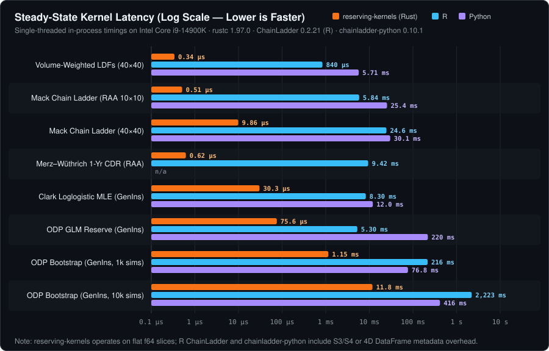

<p align="center">
  
</p>

<p align="center">
  <strong>Pure Rust numeric kernels for P&amp;C actuarial reserving and reserve-risk capital modeling.</strong>
</p>

<p align="center">
  <a href="https://crates.io/crates/reserving-kernels"></a>
  <a href="https://docs.rs/reserving-kernels"></a>
  <a href="https://github.com/SinisterRob/reserving-kernels/actions/workflows/ci.yml"></a>
  <a href="https://github.com/SinisterRob/reserving-kernels/blob/main/Cargo.toml"></a>
  <a href="#license"></a>
  <a href="https://github.com/SinisterRob/reserving-kernels/blob/main/src/lib.rs"></a>
  <a href="https://github.com/SinisterRob/reserving-kernels/blob/main/Cargo.toml"></a>
  <a href="#building-and-testing"></a>
</p>

<p align="center">
  <a href="#quick-start">Quick Start</a> &nbsp;·&nbsp;
  <a href="https://github.com/SinisterRob/reserving-kernels/blob/main/docs/examples/mack-chain-ladder-raa.md">Worked Example</a> &nbsp;·&nbsp;
  <a href="#implemented-modules">Modules</a> &nbsp;·&nbsp;
  <a href="#performance">Performance</a> &nbsp;·&nbsp;
  <a href="#verification">Verification</a> &nbsp;·&nbsp;
  <a href="#building-and-testing">Build &amp; Test</a> &nbsp;·&nbsp;
  <a href="https://github.com/SinisterRob/reserving-kernels/blob/main/docs/SOURCES.md">Literature</a>
</p>

---

`reserving-kernels` covers retrospective loss development, stochastic reserving, and the **reserve risk** module of capital modeling (1-year CDR, multi-line dependence, and capital allocation). For prospective ratemaking, reinsurance layering, and underwriting risk, see its sibling crate [`pricing-kernels`](https://github.com/SinisterRob/pricing-kernels). Every method is implemented from peer-reviewed actuarial literature ([`docs/SOURCES.md`](https://github.com/SinisterRob/reserving-kernels/blob/main/docs/SOURCES.md)) and verified against published benchmark triangles ([`tests/source_benchmarks.rs`](https://github.com/SinisterRob/reserving-kernels/blob/main/tests/source_benchmarks.rs)).

## Why `reserving-kernels`?

- **Zero heavy dependencies:** Pure Rust with no BLAS, LAPACK, FFTW, or `ndarray`. Linear algebra, IRLS, and FFT routines are built in and compile cleanly to `wasm32` (`--features wasm`).
- **Validated flat triangles:** Row-major `f64` grids using `NaN` for unobserved cells, with explicit monotonicity validation and support for negative development in incurred or reinsurance triangles.
- **Deterministic by design:** Fixed-seed PRNG streams and custom samplers keep ODP bootstraps, multi-line correlations, and Monte Carlo runs deterministic and reproducible on each target.

## Quick Start

Add `reserving-kernels` to your `Cargo.toml`:

```toml
[dependencies]
reserving-kernels = "0.4"
```

Basic triangle reserving and aggregate loss convolution:

```rust
use reserving_kernels::{prelude::*, triangle};

fn main() -> Result<(), ValidationError> {
    // Build from upper-triangle rows (no manual NaN padding needed)
    let triangle = triangle![
        [100, 160, 195, 205],
        [120, 190, 232],
        [135, 218],
        [150],
    ]?;

    // Mack ultimate reserve & standard error
    let mack = triangle.mack(1.0)?;
    println!(
        "Mack reserve: {:.2} (SE: {:.2}, CV: {:.1}%)",
        mack.total_reserve,
        mack.total_standard_error,
        mack.total_cv * 100.0,
    );

    // Merz–Wüthrich 1-year Claims Development Result (Solvency II)
    let cdr = triangle.merz_wuthrich()?;
    println!("1-yr CDR SE:  {:.2}", cdr.total_cdr_standard_error);
    assert!(cdr.total_cdr_standard_error <= mack.total_standard_error);

    // Aggregate loss: Panjer recursion vs. FFT
    let freq = FrequencyDistribution::Poisson { lambda: 3.0 };
    let severity_pmf = [0.0, 0.5, 0.3, 0.2];
    let panjer = panjer_recursion(freq, &severity_pmf, 100.0, 128)?;
    let fft = fft_aggregate_loss(freq, &severity_pmf, 100.0, 128, None)?;
    assert!((panjer.mean - fft.mean).abs() < 1e-8);

    Ok(())
}
```

## Implemented Modules

`reserving-kernels` is organized into clean domain modules (`deterministic`, `stochastic`, `capital`, `excess`, `preprocessing`, `diagnostics`, `subannual`, `datasets`, `types`, `validate`, plus the zero-dep `triangle!` macro and optional `wasm_exports` behind `--features wasm`).

| Domain Module | Highlights |
| --- | --- |
| **`deterministic`** | Chain Ladder, Bornhuetter–Ferguson, Benktander, Cape Cod (standard & generalized), Berquist–Sherman, Munich & Double Chain Ladder, Schnieper, Separation, Credibility CL |
| **`stochastic`** | Mack (uni/multivariate & BF), Merz–Wüthrich 1-yr CDR, England–Verrall–Wüthrich 1-yr run-off, ODP/Gamma/Tweedie GLMs, ODP Bootstrap, Paid–Incurred Chain, Clark MLE, PTF, Kalman & micro-reserving |
| **`capital`** | Iman–Conover rank correlation, synchronized multi-line bootstrap, Panjer & FFT aggregate loss convolution, VaR/TVaR/RVaR, Euler & Myers–Read allocation |
| **`excess`** | Parametric severity & LEV/excess ratios, excess-layer simulation, and excess/limited loss development |
| **`preprocessing` & `diagnostics`** | Triangle transforms, ragged helpers, large-loss capping, trending, on-leveling, holdout LDF backtesting, roll-forwards, exhibits, and Mack diagnostic tests |
| **`subannual`** | Asymmetric grids (2:1/4:1/12:1), 7 sub-annual CDF/LDF interpolators (SWIMON, Spliced Weibull, IVF12), Bloom stubs, exact-age Clark & asymmetric ODP |

<details>
<summary><strong>Full module directory</strong></summary>

### Core (`types`, `validate`, `datasets`, `triangle!`)

| Module | Capabilities |
| --- | --- |
| `types`, `validate` | Pure row-major `Triangle` / `TriangleView`, monotonicity policies, validation errors, and `triangle!` literal macro |
| `datasets` | Zero-I/O benchmark triangles (RAA, GenIns, Quarg & Mack, Friedland Auto) |

### `deterministic` — Loss Development & Point Estimators

| Module | Capabilities |
| --- | --- |
| `deterministic::ldf` | Volume-weighted, simple, geometric, median, trimmed, last-N, and masked LDFs/CDFs |
| `deterministic::tail` | Bondy, Generalized Bondy, Exponential, Inverse Power, Weibull, Clark growth-curve, and Mack tail variance |
| `deterministic::chain_ladder` | Unchecked hot-path kernels and checked `ChainLadderEngine` |
| `deterministic::bf` | Bornhuetter–Ferguson reserve indications with scalar, vector, or a priori inputs |
| `deterministic::benktander` | Closed-form m-iteration credibility recursion and MSE-optimal weights |
| `deterministic::cape_cod`, `generalized_cape_cod` | Standard and decay-weighted Cape Cod ELR estimation |
| `deterministic::case_outstanding` | Paid-to-case and case-to-case development from aligned triangles |
| `deterministic::incremental_additive` | Exposure-weighted incremental loss ratios with optional trend |
| `deterministic::berquist_sherman` | Case-reserve adequacy restatement and paid disposal-rate interpolation |
| `deterministic::brosius`, `murphy` | Centered OLS credibility and generalized weighted-regression CL with exact MSE |
| `deterministic::separation` | Arithmetic and geometric separation of delay patterns and calendar inflation |
| `deterministic::credibility_cl` | Bühlmann–Straub shrinkage of LDFs toward collective priors with analytical MSEP |
| `deterministic::munich_chain_ladder` | Bivariate paid/incurred CL closing the paid-vs-incurred gap |
| `deterministic::schnieper` | Two-triangle True IBNR vs. IBNER separation with Mack-style MSEP |
| `deterministic::double_chain_ladder` | Paid + count deconvolution into reporting/payment delays, severity inflation, and RBNS/IBNR |

### `stochastic` — Stochastic Reserving, 1-Year Risk & GLMs

| Module | Capabilities |
| --- | --- |
| `stochastic::mack`, `multivariate_mack` | Distribution-free CL standard errors (single & correlated multi-line) with stochastic tails |
| `stochastic::mack_bf` | Analytical BF MSEP decomposing process, prior, pattern, and interaction variance |
| `stochastic::merz_wuthrich` | 1-year Solvency II CDR analytical MSEP and multi-year run-off decomposition |
| `stochastic::reserve_runoff` | England–Verrall–Wüthrich (2019) fixed-history 1-year re-reserving simulation (Mack & ODP) |
| `stochastic::multivariate_cl` | Joint K-line Diagonal MCL and General GMCL with full cross-line covariance |
| `stochastic::paid_incurred_chain` | Bayesian log-normal joint paid/incurred model with closed-form posterior & MSEP |
| `stochastic::hertig` | Exact closed-form log-normal link-ratio moments and quantiles |
| `stochastic::kalman_reserving` | Recursive Kalman filter over calendar diagonals for dynamic inflation shifts |
| `stochastic::micro_reserving` | Individual-claim reserving (NHPP, reporting delay, multi-state RBNS + IBNR simulation) |
| `stochastic::clark_mle` | Loglogistic & Weibull growth-curve ODP MLE with Cramér–Rao standard errors |
| `stochastic::ptf_regression` | Probabilistic Trend Family log-linear regression for accident, dev, and calendar trends |
| `stochastic::glm_reserving` | Built-in Householder QR IRLS engine for ODP, Gamma, Tweedie, and Log-normal GLMs |
| `stochastic::bootstrap_odp` | ODP GLM bootstrap with hat-matrix leverages, process variance, and 1-year CDR re-reserving |

### `capital` — Dependence, Aggregate Loss & Capital Allocation

| Module | Capabilities |
| --- | --- |
| `capital::dependence` | Iman–Conover rank reordering and synchronized multi-line ODP bootstrap |
| `capital::reserve_distribution` | Empirical moments, VaR, coherent TVaR, and RVaR |
| `capital::aggregate_loss` | Panjer (a, b, 0) recursion, exponentially tilted FFT, and severity discretization |
| `capital::capital_allocation` | Euler allocation (TVaR, RVaR, SD) and Myers–Read marginal default-put allocation |

### `excess`, `preprocessing`, `diagnostics` & `subannual`

| Module | Capabilities |
| --- | --- |
| `excess::severity`, `excess_layers`, `excess_development` | Closed-form LEV/survival/PDF, excess layer simulation, and excess/limited development factors |
| `diagnostics` | Mack Spearman & calendar-year tests, actual vs. expected, leave-one-out fragility, and paid/incurred reconciliation |
| `subannual` | Asymmetric grids (2:1/4:1/12:1), 7 CDF/LDF interpolators (SWIMON, Spliced Weibull, IVF12), Bloom stubs, asymmetric CL/BF/Cape Cod/Clark/ODP, and parity checks |
| `preprocessing::triangle`, `triangle_algebra`, `ragged` | Cumulative/incremental transforms, ragged link selectors, and allocation-free slice kernels |
| `preprocessing::selection`, `reserve_rollforward`, `exhibit` | Holdout LDF backtesting, valuation roll-forwards, and JSON exhibit DTOs |
| `preprocessing::large_loss`, `trend`, `onlevel`, `count_development`, `apriori`, `aggregate` | Large-loss capping, trending, parallelogram on-leveling, count development, a priori builders, and aggregation |

</details>

## Performance

Single-threaded benchmarks on an Intel Core i9-14900K comparing `reserving-kernels` (`--release`) against `mages/ChainLadder` 0.2.21 (R) and `casact/chainladder-python` 0.10.1 (Python) on identical triangles:

<p align="center">
  
</p>

| Benchmark | `reserving-kernels` | R `ChainLadder` | `chainladder-python` | vs. R | vs. Python |
| --- | :---: | :---: | :---: | :---: | :---: |
| Volume-Weighted LDFs (40×40) | **0.30 µs** | 840 µs | 5,710 µs | 2,830× | 19,250× |
| Mack Chain Ladder (RAA 10×10) | **0.27 µs** | 5,840 µs | 25,446 µs | 21,620× | 94,200× |
| Mack Chain Ladder (40×40) | **2.62 µs** | 24,650 µs | 30,077 µs | 9,410× | 11,480× |
| Merz–Wüthrich 1-Yr CDR (RAA) | **0.38 µs** | 9,420 µs | — | 24,580× | — |
| Clark Loglogistic MLE (GenIns) | **11.7 µs** | 8,300 µs | 12,026 µs | 711× | 1,030× |
| ODP GLM Reserve (GenIns) | **1.20 µs** | 5,300 µs | 219.6 ms | 4,410× | 182,860× |
| ODP Bootstrap (GenIns, 1k sims) | **0.19 ms** | 216.5 ms | 76.8 ms | 1,160× | 410× |
| ODP Bootstrap (GenIns, 10k sims) | **1.90 ms** | 2,223 ms | 416.2 ms | 1,170× | 220× |

<details>
<summary><strong>Additional i9-14900K Rust kernel latencies (20 more kernels in <code>benches/kernels.rs</code>)</strong></summary>

| Kernel | Median (`i9-14900K`) | Domain |
| --- | :---: | --- |
| Excess Layers Lookup (65k sims) | **34.6 ns** | `excess` |
| ODP Fit (GenIns 10×10) | **0.73 µs** | `stochastic` |
| General Multivariate CL (GMCL, 2-line 10×10) | **3.32 µs** | `stochastic` |
| Merz–Wüthrich 1-Yr CDR (40×40) | **4.56 µs** | `stochastic` |
| Paid–Incurred Chain (Friedland 10×10) | **6.94 µs** | `stochastic` |
| Coherent TVaR (10k scenarios) | **9.83 µs** | `capital` |
| Panjer Recursion (512 steps) | **13.9 µs** | `capital` |
| Double Chain Ladder (40×40) | **15.4 µs** | `deterministic` |
| PTF Log-Linear Regression (GenIns 10×10) | **16.9 µs** | `stochastic` |
| Reserve Distribution Summary (10k scenarios) | **19.3 µs** | `capital` |
| Multivariate Mack (2-line 40×40) | **22.3 µs** | `stochastic` |
| Clark Weibull MLE (GenIns 10×10) | **25.9 µs** | `stochastic` |
| Kalman State-Space Filter (GenIns 10×10) | **26.7 µs** | `stochastic` |
| Gamma GLM Reserve (GenIns 10×10) | **87.3 µs** | `stochastic` |
| Tilted Radix-2 FFT Aggregate Loss (4,096 pts) | **122 µs** | `capital` |
| Euler TVaR Capital Allocation (10k × 5 lines) | **129 µs** | `capital` |
| Myers–Read Allocation (10k × 5 lines) | **168 µs** | `capital` |
| Synchronized Multi-Line ODP Bootstrap (2-line, 500 sims) | **191 µs** | `capital` |
| ODP 1-Yr CDR Bootstrap (GenIns, 1k sims) | **226 µs** | `stochastic` |
| Iman–Conover Rank Correlation (2k × 3 lines) | **314 µs** | `capital` |
| Individual-Claim Micro-Reserving (1k sims) | **1.57 ms** | `stochastic` |

</details>

*Note: `reserving-kernels` operates directly on validated `f64` slices with reusable scratch space, whereas the R and Python libraries carry DataFrame and S3/S4 object overhead. All point estimates and Mack / Merz–Wüthrich standard errors were verified for numerical parity before timing.*

## Verification

Kernels are tested against published actuarial datasets and closed-form mathematical identities:

- **Worked example:** [Mack Chain-Ladder in Rust: A Worked Example](https://github.com/SinisterRob/reserving-kernels/blob/main/docs/examples/mack-chain-ladder-raa.md) reproduces Mack (1993) Table 2 on the RAA 10×10 triangle cell-for-cell (`cargo run --example mack_raa`).
- **Benchmark triangles:** Mack (1993) RAA, Taylor & Ashe / England & Verrall GenIns, Friedland US Industry Auto, and Quarg & Mack (2004).
- **1-Year Solvency & Sub-Annual Parity:** England, Verrall & Wüthrich (2019) Table 2 fixed-history 1-year re-reserving (`stochastic::reserve_runoff`) and Robbin (2018) SWIMON equilibrium IBNR monotonicity (`subannual`).
- **Exact identities:** Merz–Wüthrich multi-year run-off summing to Mack ultimate MSEP; ODP GLM matching exact analytical leverages and dispersion; Panjer vs. FFT aggregate loss agreement; and full-allocation conservation for Euler TVaR and Myers–Read.

Full citations and equation mappings live in [`docs/SOURCES.md`](https://github.com/SinisterRob/reserving-kernels/blob/main/docs/SOURCES.md); parity tests live in [`tests/source_benchmarks.rs`](https://github.com/SinisterRob/reserving-kernels/blob/main/tests/source_benchmarks.rs).

## Building and Testing

```bash
# Run unit, integration, doctest, and benchmark-parity tests
cargo test --all-targets --all-features
cargo test --doc --all-features

# Run the Mack (1993) RAA worked example or JSON exhibit example
cargo run --example mack_raa
cargo run --example export_exhibit

# Run Criterion benchmarks (benches/kernels.rs & benches/triangle_algebra.rs)
cargo bench --bench kernels -- --save-baseline main
cargo bench --bench kernels -- --baseline main

# Profile a specific kernel under release optimization (requires samply)
samply record cargo bench --bench kernels -- glm_odp_genins --profile-time 5

# Build for WebAssembly
cargo build --release --target wasm32-unknown-unknown --features wasm
```

## License

Licensed under either of [MIT](https://github.com/SinisterRob/reserving-kernels/blob/main/LICENSE-MIT) or [Apache-2.0](https://github.com/SinisterRob/reserving-kernels/blob/main/LICENSE-APACHE) at your option.
